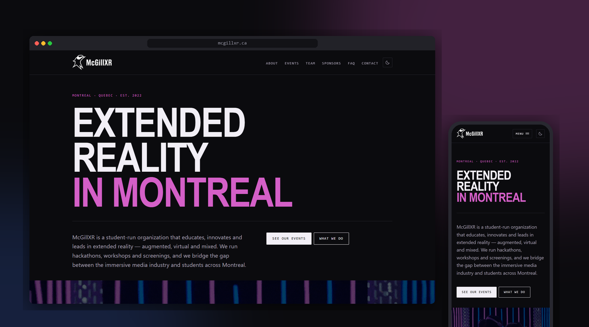
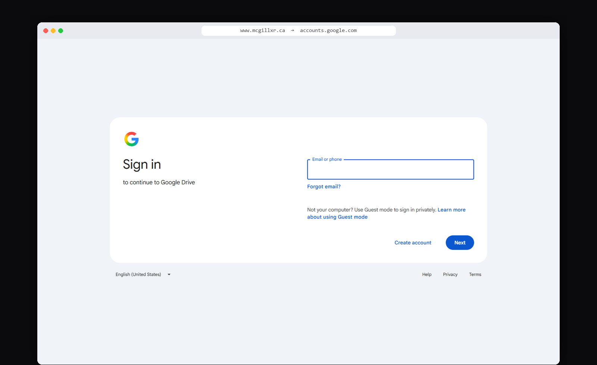
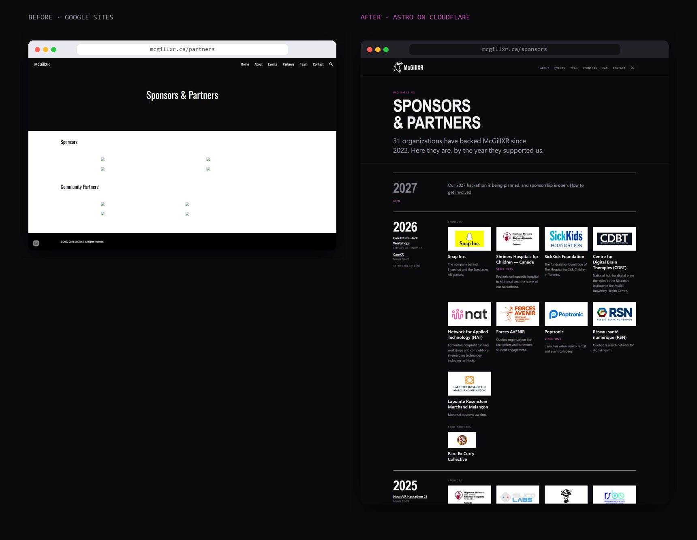
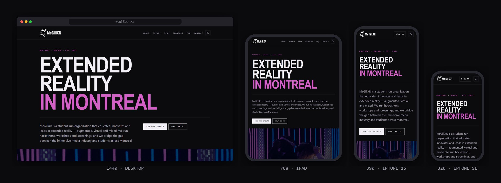

# Rebuilding mcgillxr.ca

I'm the VP Technology of [McGillXR](https://mcgillxr.ca), a student-run XR club in Montreal.
In September 2026 I inherited a website the public couldn't open. By October 16 it was live at
`mcgillxr.ca`.

This repo is the write-up. The code is private to the club.

*What anyone visiting www.mcgillxr.ca saw before.*

## The problems

1. [Nobody could see the site](docs/01-nobody-could-see-the-site.md). Traced the domain and found the actual blocker.
2. [Our history was behind a login](docs/02-getting-our-history-out.md). Scraped it with a signed-in browser.
3. [The old site was wrong](docs/03-the-old-site-was-wrong.md). Checked the content against the club's records.
4. [The site had to survive me leaving](docs/04-a-site-that-outlives-me.md). Static, content as files, mistakes break the build.
5. [Posters broke every grid](docs/05-posters-broke-the-grid.md). Why cropping and shrinking didn't work, and what did.
6. [The menu flickered on 3G](docs/06-the-menu-flickered-on-3g.md). Three symptoms, one cause.
7. [Moving the domain](docs/07-moving-the-domain.md). A switch that could be undone at every step.
8. [Photos of real people](docs/08-photos-of-real-people.md). Metadata, credit and consent.

## Before and after

*Left: the old Partners page as the Internet Archive saved it in 2024, without its images. Right: the new Sponsors page.*

| | Before | After |
| --- | --- | --- |
| Who can see it | Only accounts with access | Everyone |
| Events | One past-events page | 21 events from 2022 to 2026, the major ones with their own page |
| Sponsors | Logos only, no years | 31, by year, each sourced |
| Lighthouse | n/a | 100 accessibility, 100 SEO, 99+ performance on desktop |

Built with Astro and hosted on Cloudflare. Full-page screenshots are in
[`screenshots/`](screenshots).

---

Ahmed Gara Ali · VP Technology, McGillXR · McGillXR is independent and not affiliated with McGill University.
