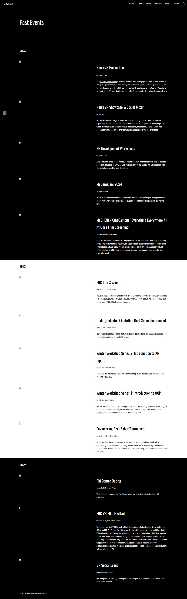

# 2. Our history was behind a login

[← Previous](01-nobody-could-see-the-site.md) · [Home](../README.md) · [Next →](03-the-old-site-was-wrong.md)

## The problem

Most of the club's history since 2022 (event write-ups, photos, the team and sponsor logos)
was on the private Google Site. The CareXR hackathon had a second Google Site of its own. I
needed all of it before changing anything.

## Why a normal download wasn't enough

Requests that aren't signed in just get redirected to Google's login page:

```console
$ curl -sI https://sites.google.com/view/mcgillxr
HTTP/1.1 302 Found
Location: https://accounts.google.com/ServiceLogin?...
```

The Internet Archive has copies of some old pages from when they were public, but the
images didn't survive. The page below is the archive's copy of the old "Past Events" page:



## What I did

I used a scraper that runs a real Chrome browser with its own profile. You sign in once with
a Google account that has access, the session is saved in that profile, and then the scraper
goes through the site saving page text, images and screenshots.

I ran it on both Google Sites. The CareXR site alone had about 280 event photos from NeuroVR
2024, NeuroVR 2025 and CareXR 2026.

For what the sites didn't have, I used:

- Luma, for the club's event listings
- Devpost, for hackathon projects, winners and sponsor lists
- the club's event summaries and sponsorship prospectus
- photos of event T-shirts, banners and slides from Instagram and other social media, to
  work out which sponsors backed which year

## Cleaning up

A saved Google session works like a password, so I deleted it on October 7.

My first commit history had the scraper and its output mixed in with the website. I replaced
that history, so the website repo only holds the website. The scraper and raw data went into
a separate archive folder, with a README listing what each item is.
