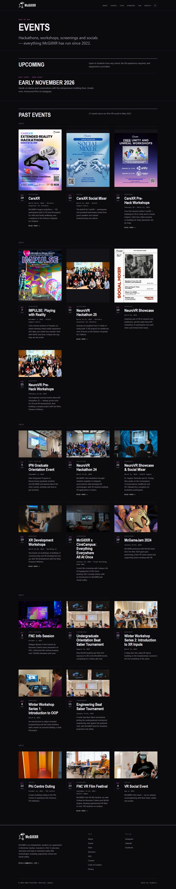

# 5. Posters broke every grid

[← Previous](04-a-site-that-outlives-me.md) · [Back](../README.md) · [Next →](06-the-menu-flickered-on-3g.md)

## The problem

Event photos are wide and event posters are tall. Put both in the same row and the layout
fell apart.

## What I tried first

- Cropping the posters cut off their titles.
- Shrinking them made them unreadable.
- Leaving them alone pushed the text on the cards next to them 280 px out of line.

## The solution

Photos get a light crop, and posters are never cropped or resized. I used CSS subgrid so
each row grows to fit its tallest picture, which keeps the text on every card in that row
lined up.

